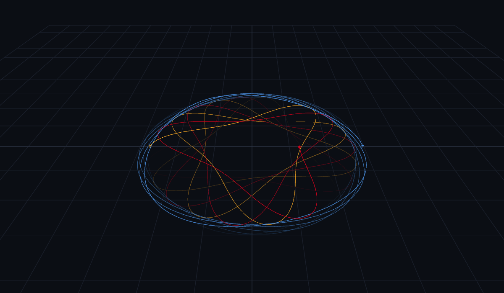
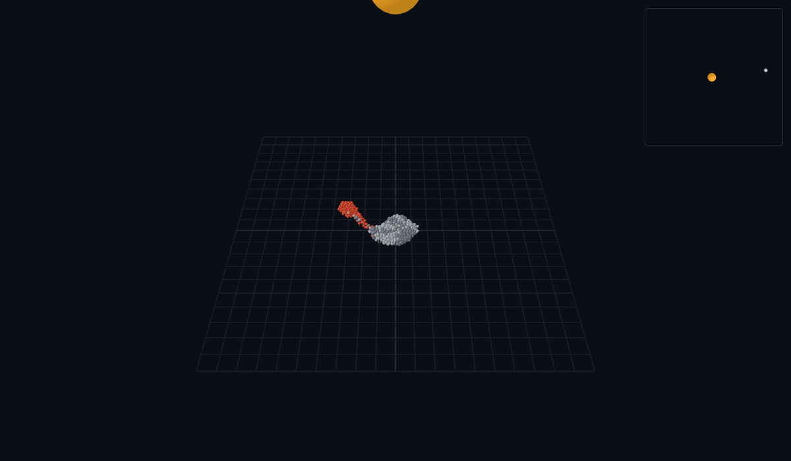

# Three-Body Gravity Engine

Gravity, simulated live in your browser: classic three-body orbits, chaos you can watch grow,
stars that steal planets, and moons torn apart by tides.

**Try it: https://sagnik-nandi.github.io/Three-Body-Gravity-Engine/**

| | |
|---|---|
|  |  |

## Run it locally

Needs [Node.js](https://nodejs.org), with nothing to install:

```
cd web
npm start
```

Then open http://localhost:8000. To run the tests, use `npm test` in `web/`.

## What's here

- `web/`: the page and the JavaScript engine it runs: 3D N-body physics with merges, and bodies made of rocks.
- `python/`: the first version of the engine, kept as the reference the JavaScript is checked against.

## More

- [Presets](doc/presets.md): every experiment, what you should see, and what its test checks
- [Web view](doc/web-view.md): controls, link options, deploying
- [Physics](doc/physics.md): the integrator, chaos, merges, tides, and rubble piles
- [Python version](doc/python.md): running it, and its options
- [Development](doc/development.md): project layout, tests, roadmap
