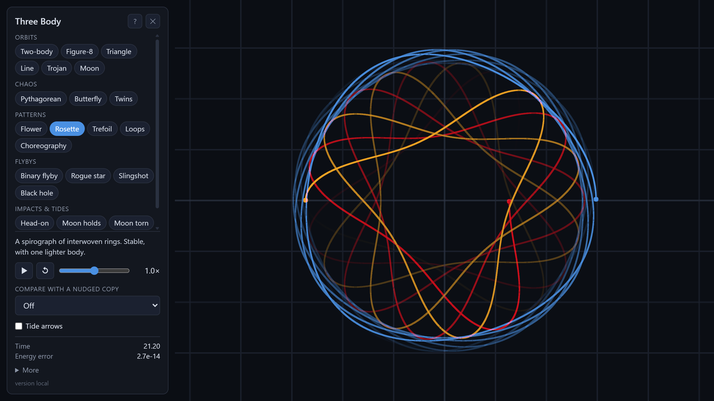
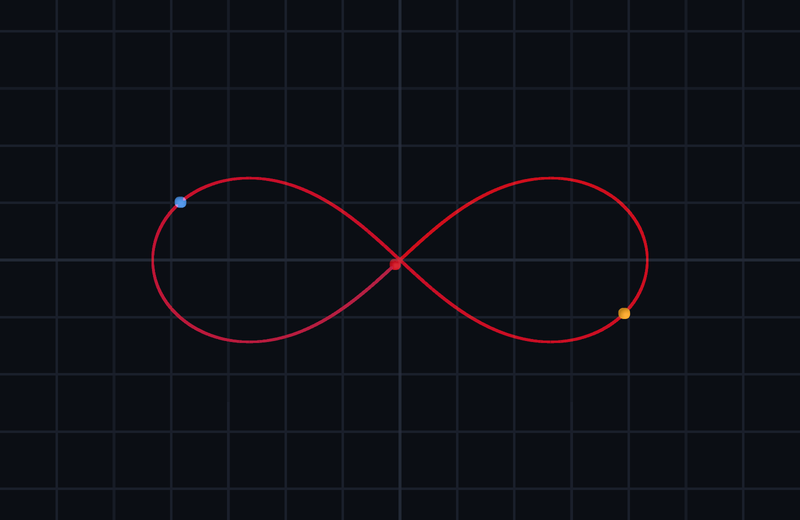
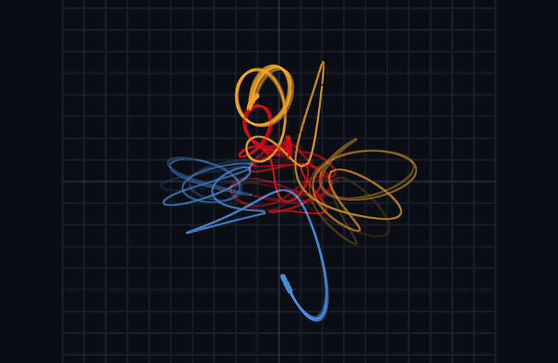
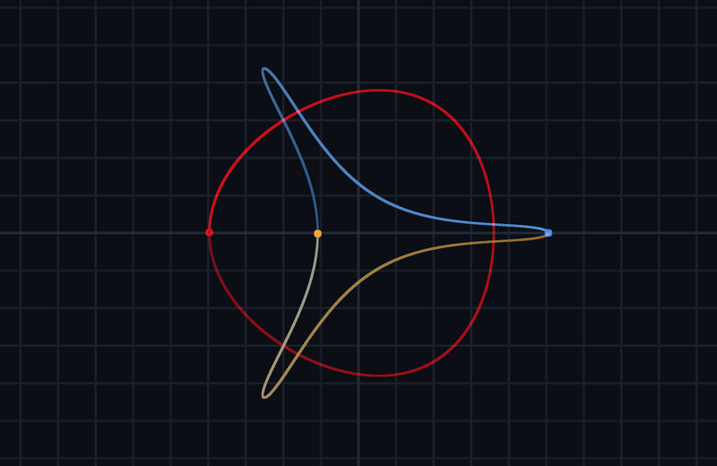
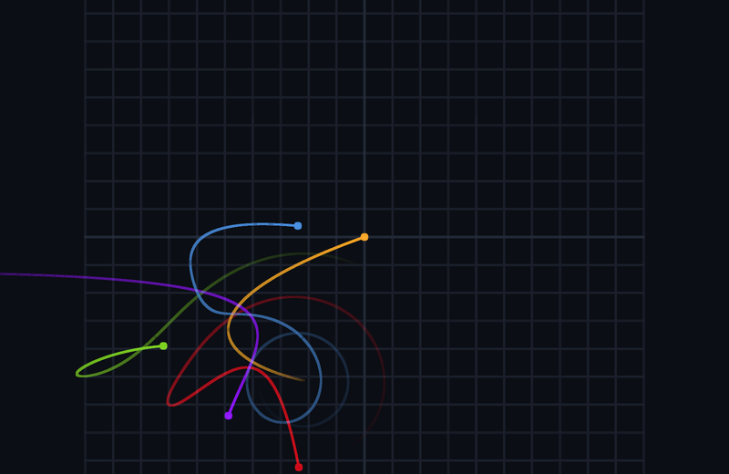
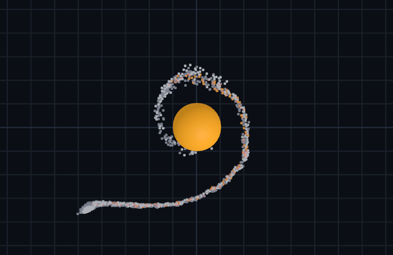

# Three-Body Gravity Engine

A gravity simulator that runs live in your browser. Pick an experiment and watch it happen: three
stars sharing one orbit, tiny differences growing into chaos, a passing star stealing a planet, a moon
torn apart by tides. Nothing is pre-recorded: every motion is computed from Newton's law of gravity as
you watch.

The idea came from the three-body game in Liu Cixin's novel *The Three-Body Problem*.

**[Try it online](https://sagnik-nandi.github.io/Three-Body-Gravity-Engine/)**: no install needed.



## What you can try

The 3D page has over 20 experiments in five groups. Drag to rotate and scroll to zoom.

| | | |
|---|---|---|
|  |  |  |
| **Orbits.** Classic solutions, like three equal masses chasing each other around one figure-8. | **Chaos.** 30 almost identical copies scatter. You can also compare a nudged copy side by side. | **Patterns.** Published periodic orbits. Some are stable, others last only seconds or minutes. |
|  |  |  |
| **Flybys.** A rogue star wrecks a solar system, a probe takes a slingshot, a black hole splits a pair of stars. | **Impacts & tides: Moon torn.** A moon of 1,000 rocks holds together, or gets shredded if it orbits inside the Roche limit. | **Impacts & tides: Giant impact.** Planets merge, and a giant impact throws out a short-lived moon. |

## How it works

- **Accurate orbits.** A 4th-order symplectic integrator (Yoshida), with a time step that shrinks
  during close passes.
- **Chaos without randomness.** The simulation is deterministic: chaos comes only from tiny differences
  growing, and you can set their size yourself.
- **Bodies made of rocks.** Particle bodies have only gravity and contact forces between rocks. Tides
  need no code of their own, and the Roche limit emerges by itself.
- **Checked against known answers.** Tests compare the presets with known results, and the JavaScript
  engine is cross-checked against the original Python one.

## Run it locally

You need [Node.js](https://nodejs.org), with no packages to install:

```
cd web
npm start      # then open http://localhost:8000
npm test       # 70 physics tests, about 30 s
```

Pushing to `main` runs the tests and publishes the page to GitHub Pages.

## Project layout

| Path | What it is |
|---|---|
| `web/` | The page, and the JavaScript engine it runs |
| `python/` | The first version of the engine, kept as the reference the JavaScript is checked against |
| `doc/` | The detailed notes linked below |

## Documentation

- [Presets](doc/presets.md): every experiment, what you should see, and what its test checks
- [Web view](doc/web-view.md): controls, link options, and deploying
- [Physics](doc/physics.md): the integrator, chaos, merges, tides, and rubble piles
- [Python version](doc/python.md): running it, and its options
- [Development](doc/development.md): detailed layout, tests, and the full roadmap

## What's next

- Bigger impacts on the GPU (about 10,000 particles)
- Drag-to-launch: place bodies and set their velocity with the mouse
- The solar system with real data, and black hole inspirals
